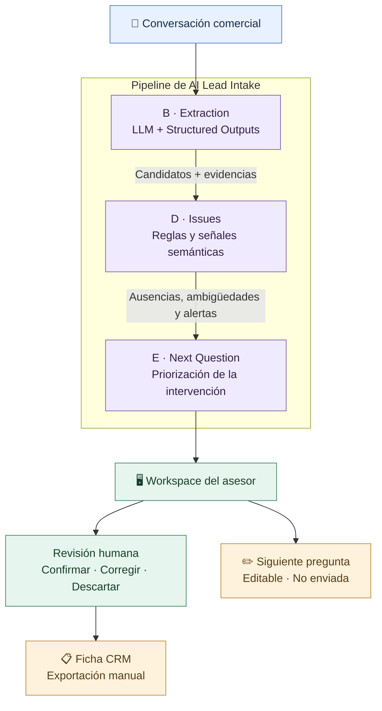

# Libeen AI Lead Intake V0

**AI Product Engineer Technical Challenge — Proof of Concept**

Una herramienta de asistencia comercial que transforma conversaciones no estructuradas en información accionable, preservando las evidencias, haciendo visibles las incertidumbres y manteniendo al asesor humano como responsable de las decisiones.

**Estado:** Proof of Concept funcional, validada para una demostración supervisada con limitaciones. No preparada para producción.

## 1. Executive Summary

### El problema

Durante la cualificación inicial de un potencial cliente, un asesor comercial necesita identificar información dispersa en una conversación, determinar qué datos faltan, detectar posibles contradicciones y decidir qué preguntar a continuación.

Esto implica varias tareas manuales:

- Leer y reconstruir conversaciones completas.
- Extraer información comercial en un formato consistente.
- Identificar información incompleta, ambigua o contradictoria.
- Priorizar la siguiente intervención.
- Preparar una ficha para el CRM sin perder el contexto original.

### La solución

**Libeen AI Lead Intake** es una PoC que asiste al asesor durante ese proceso.

A partir de una conversación ficticia, el sistema:

1. Extrae información comercial mediante un LLM.
2. Conserva las fuentes y los metadatos de cada declaración.
3. Detecta datos ausentes, ambigüedades y situaciones que requieren revisión.
4. Propone una única siguiente pregunta o intervención.
5. Permite al asesor confirmar, corregir o descartar información.
6. Mantiene las revisiones y señala conflictos cuando la conversación evoluciona.
7. Prepara una ficha comercial para copiarla manualmente al CRM.

La principal decisión de producto es **no confundir automatización con autonomía**.

La IA propone interpretaciones; el sistema aplica controles y reglas; el asesor conserva la decisión final.

### Qué pretende demostrar la PoC

No buscamos demostrar que un LLM puede interpretar perfectamente cualquier conversación comercial.

Queremos comprobar si es posible construir un flujo útil donde la IA reduzca el trabajo de estructuración y ayude a identificar la siguiente acción, sin convertir automáticamente información incierta en hechos consolidados.

El resultado es una **PoC supervisada**, no un sistema comercial autónomo.

---

## 2. Capacidades implementadas

### 2.1. Análisis de conversaciones

El asesor puede seleccionar una conversación ficticia de ejemplo o introducir texto libre identificando los turnos de `Cliente`, `Libeen` o `Asesor`.

El análisis se inicia expresamente mediante una acción del usuario; no se ejecuta automáticamente al escribir.

La conversación se procesa mediante una ruta de servidor que llama a OpenAI.

El parser comprueba que los turnos tengan un emisor reconocible y rechaza entradas ambiguas o mal formadas antes de enviarlas al modelo.

Los marcadores de audio sin transcripción se conservan como contenido inaccesible: el sistema no inventa su contenido.

### 2.2. Extracción de información comercial

El módulo de extracción propone valores para siete campos:

| Campo | Ejemplo |
|---|---|
| Interés en SmartHousing | Quiere explorar SmartHousing |
| Zona de búsqueda | Alicante |
| Horizonte de mudanza | Dentro de ocho meses |
| Compradores | Una persona |
| Ingresos mensuales | Aproximadamente 2.750 € netos |
| Ahorros declarados | 11.000 € |
| Cuotas o deudas mencionadas | 145 €/mes |

La extracción es parcial por diseño: un campo ausente o incorrecto no obliga a descartar toda la ficha.

Cada candidato conserva, cuando corresponde:

- Mensaje y fragmento de origen.
- Precisión: explícito, aproximado, rango o incierto.
- Sujeto: individual, conjunto o desconocido.
- Base de ingresos: neta, bruta o desconocida.
- Estado de inclusión de una cuota en los ingresos.
- Incertidumbres señaladas por el modelo.

**Una fuente literal demuestra de dónde procede el texto, pero no garantiza que la interpretación semántica sea correcta.**

Los valores extraídos se consideran declaraciones del cliente, no información verificada documentalmente.

### 2.3. Detección de incidencias

El sistema identifica cuatro categorías principales:

| Categoría | Ejemplo | Tratamiento |
|---|---|---|
| Información ausente | No conocemos los ahorros | Solicitar información |
| Ambigüedad o conflicto | No sabemos si una cuota está descontada | Preguntar o revisar |
| Contenido inaccesible | Audio sin transcripción | No inferir contenido |
| Solicitud sensible | Petición de garantía, aprobación o no contacto | Revisión humana |

Las incidencias pueden utilizar señales semánticas del modelo y comprobaciones deterministas sobre los candidatos extraídos.

Por ejemplo, si existe una cuota declarada cuya inclusión en los ingresos es desconocida, el sistema puede generar una incidencia incluso si el modelo omite esa señal.

No pretende detectar perfectamente todas las situaciones sensibles ni resolver automáticamente todos los conflictos.

### 2.4. Siguiente pregunta prioritaria

El sistema propone una única intervención a partir de los datos e incidencias disponibles.

La prioridad general es:

1. Revisión humana de una situación sensible.
2. Aclaración de una ambigüedad material.
3. Solicitud de un campo esencial ausente.
4. Ninguna pregunta prioritaria, si no corresponde intervenir.

La pregunta es editable y puede copiarse, pero nunca se envía automáticamente al cliente.

La formulación es una propuesta: puede necesitar corrección por parte del asesor.

### 2.5. Revisión y reconciliación humana

El asesor puede confirmar, corregir o descartar candidatos.

Cuando aparece información nueva, el sistema permite reanalizar la conversación y contrastar los candidatos con las revisiones anteriores.

Una corrección humana no debería desaparecer silenciosamente ante una nueva extracción.

Cuando no existe una correspondencia suficientemente clara, se mantiene un conflicto o una revisión pendiente en lugar de seleccionar arbitrariamente un valor.

Un aprendizaje importante de la implementación fue la necesidad de distinguir entre **lo que la interfaz muestra como seleccionado** y **el valor efectivo que utiliza el resto del sistema**.

Esto motivó la corrección P8.1 y la introducción de una representación compartida de la ficha efectiva mediante `deriveEffective`.

### 2.6. Etapa comercial y ficha CRM

El sistema maneja las etapas:

- `Nuevo`
- `En cualificación`
- `Cualificado`

Representan el grado de completitud de la información comercial, **no la solvencia ni la aprobación financiera del cliente**.

La ficha CRM presenta los valores disponibles, su procedencia, los campos ausentes y las incidencias.

La exportación se realiza mediante copia manual al portapapeles. No existe sincronización con un CRM real.

La aplicación puede bloquear la copia cuando detecta resultados desactualizados, conflictos sin resolver, ausencia de información utilizable o una etapa incoherente con la recomendación vigente.

---

## 3. Arquitectura y decisiones técnicas

### 3.1. Stack

| Capa | Tecnología |
|---|---|
| Aplicación web | Next.js 16, React 19, TypeScript |
| API | Next.js Route Handlers |
| Inferencia | OpenAI Responses API |
| Validación estructurada | Zod |
| Tests unitarios e integración | Vitest |
| Tests de navegador | Playwright |
| Accesibilidad automatizada | Axe |
| Persistencia | En memoria |


El objetivo fue mantener una arquitectura pequeña, fácil de inspeccionar y suficiente para el recorrido principal de la prueba. He decidido no usar una base de datos en este PoC y manejar la persistencia con memoria temporal. Así reducimos dependencias innecesarias para esta fase y el Coding Agent puede centrar los esfuerzos en validar el objetivo principal. 

No hay microservicios, infraestructura distribuida ni un framework genérico de agentes.

### 3.2. Pipeline B → D → E

El núcleo se organiza en tres capacidades:

**B — Extraction**

Interpreta la conversación mediante el modelo y devuelve candidatos de información con fuentes y metadatos.

**D — Issues**

Analiza los candidatos y las señales disponibles para identificar información ausente, ambigüedades, contenido inaccesible y solicitudes que requieren revisión.

**E — Next Question**

Prioriza las incidencias y propone una única intervención para el asesor.

El flujo conceptual es:

`Conversación → B: candidatos y fuentes → D: incidencias → E: siguiente intervención → Workspace del asesor → revisión humana → ficha CRM manual`




### 3.3. Ejemplo de extremo a extremo

**Entrada ficticia:**

> Gano unos 2.750 euros netos al mes y pago una cuota de 145 euros mensuales. No sé si esa cuota ya está descontada de mis ingresos.

**B — Extraction**

- Ingresos: aproximadamente 2.750 €/mes.
- Base: neta.
- Cuota: 145 €/mes.
- Inclusión de cuota: desconocida.
- Fuentes: fragmentos de la conversación.

**D — Issues**

Detecta que existe una cuota y no sabemos si está incluida en los ingresos declarados.

**E — Next Question**

Puede proponer:

> ¿La cuota que habéis indicado ya está descontada de vuestros ingresos?

El asesor revisa la interpretación y decide si utilizar o modificar esa pregunta.

Esta separación facilita comprobar individualmente la extracción, el tratamiento de incidencias y la elección de la siguiente acción.

### 3.4. Qué dejamos en manos del LLM y qué no

**El LLM se utiliza para:**

- Interpretar lenguaje natural.
- Proponer valores candidatos.
- Asociar fragmentos de evidencia.
- Identificar posibles ambigüedades y señales semánticas.

**La aplicación se responsabiliza de:**

- Validar estructura y referencias.
- Rechazar candidatos sin procedencia válida.
- Calcular campos ausentes.
- Aplicar prioridades de incidencias.
- Mantener revisiones y conflictos.
- Derivar la ficha efectiva.
- Gestionar estados, errores y bloqueos.
- Preparar la exportación manual.

Las señales semánticas del modelo no se consideran verdad absoluta. Algunas comprobaciones posteriores son deliberadamente conservadoras.

La frontera entre interpretación probabilística y comportamiento determinista fue una de las decisiones arquitectónicas principales.

### 3.5. Configuración

Las reglas comerciales mínimas se encuentran en `src/intake/rules.ts`.

Permiten modificar:

- Los seis campos esenciales de completitud; las cuotas constituyen el séptimo campo comercial, pero no son obligatorias en todos los casos.
- El orden de prioridad de ambigüedades.
- La prioridad de aclarar la base neta o bruta de los ingresos.

Actualmente la configuración requiere editar TypeScript y reiniciar o reconstruir la aplicación.

**No existe un editor de reglas en la interfaz ni una configuración externa administrable sin modificar código.** Es una limitación conocida respecto al objetivo más amplio de configurabilidad.

---

## 4. Evolución del producto: por qué simplificamos el enfoque

### 4.1. Primera propuesta: Sales Copilot basado en hitos

El desarrollo comenzó con un planteamiento más ambicioso: un Sales Copilot capaz de acompañar un expediente comercial a través de distintos hitos.

Se diseñaron conceptos como:

- `Case`
- `WorkflowDefinition`
- `FactSchema`
- `AgentProfile`
- Hitos comerciales M0–M5
- Políticas deterministas y orquestación de casos

Se implementó una primera arquitectura y se construyeron recorridos de prueba.

Esa propuesta permitía explorar más decisiones comerciales, pero también incrementaba considerablemente la superficie de comportamiento que había que validar.

### 4.2. Qué revelaron los primeros experimentos

Las pruebas iniciales con OpenAI mostraron problemas de salida estructurada y de interpretación.

Conseguir un JSON válido no garantiza que el contenido represente correctamente lo que dijo el cliente.

También se experimentó con un intérprete *multipass*, separando etapas de análisis.

En una comparación con 24 escenarios sintéticos, el enfoque single-pass obtuvo 23 comprobaciones automáticas PASS frente a 2 del multipass, con 54 y 139 intentos de proveedor, respectivamente.

**Estos resultados no son tasas de precisión.** Parte de los fallos correspondía a abstenciones o bloqueos conservadores, y la revisión manual detectó falsos positivos en el propio oráculo de evaluación.

Por tanto, no se demostró una superioridad semántica universal del single-pass. Lo que sí se observó fue que añadir multipass introducía complejidad y coste sin una mejora suficientemente acreditada para el objetivo inmediato.

Se exploró asimismo LangExtract como alternativa experimental de extracción, sin incorporarlo al runtime final.

### 4.3. El pivote a AI Lead Intake

La conclusión fue reducir el problema.

En lugar de intentar llevar automáticamente un expediente por un proceso comercial completo, la PoC se centra en tres preguntas:

1. **¿Qué información podemos extraer con evidencia?**
2. **¿Qué falta o necesita revisión?**
3. **¿Cuál sería la siguiente intervención útil?**

Esto permitió acotar la arquitectura a B → D → E y construir una interfaz alrededor de la revisión humana.

La simplificación no consistió únicamente en eliminar funcionalidades. También cambió el contrato de éxito:

**De automatizar decisiones sobre el avance comercial a producir información parcial, trazable y revisable que ayude al asesor a avanzar.**

El Sales Copilot anterior se conserva como referencia histórica en la rama `archive/sales-copilot-v0` y en `docs/legacy/`.

No forma parte del runtime activo de AI Lead Intake.

---

## 5. Fiabilidad: cómo responde el sistema ante errores de la IA

La fiabilidad no depende exclusivamente de obtener mejores respuestas del modelo. También depende de cómo responde la aplicación cuando el modelo se equivoca, omite información o deja de estar disponible.

### 5.1. Errores de entrada

El parser exige turnos con autores reconocibles.

Si una conversación está vacía, contiene mensajes sin emisor identificable o mezcla marcadores de audio con contenido incompatible, devuelve un error explícito.

No intenta adivinar arbitrariamente quién dijo una afirmación.

### 5.2. Errores del proveedor o de estructura

La ruta de análisis valida la entrada, requiere una clave configurada en el servidor y utiliza una salida estructurada.

Ante errores de proveedor, formato o análisis:

- Se informa del fallo.
- No se crea una ficha nueva con información inventada.
- No se sustituye la llamada fallida por un replay oculto.
- Se conserva la entrada de trabajo para poder corregirla o reintentarla.
- Los resultados anteriores no deben presentarse como un análisis actualizado.

### 5.3. Candidatos inválidos o sin evidencia

Si la respuesta del proveedor contiene un candidato inválido, el sistema puede descartarlo sin perder necesariamente el resto de candidatos útiles.

Entre los motivos de descarte están:

- Estructura inválida.
- Referencia a un mensaje inexistente.
- Fuente atribuida al asesor en lugar del cliente.
- Contenido inaccesible.
- Fragmento que no aparece en el mensaje original.
- Expresión de interés no suficientemente explícita.

Cuando se producen descartes, el análisis puede marcarse como incompleto.

**Limitación:** verificar la existencia literal de un fragmento no demuestra que su interpretación sea semánticamente correcta.

### 5.4. Ambigüedad y ausencia de información

Se distingue entre:

- Dato desconocido.
- Valor cero explícito.
- Cantidad aproximada.
- Rango.
- Conflicto entre declaraciones.

Por ejemplo, «no tenemos ahorros» permite conservar un cero conocido, mientras que no mencionar ahorros no permite asumir que son cero.

Una cuota de inclusión desconocida puede generar una incidencia específica aunque el modelo no haya emitido una señal semántica adecuada.

No se aplican cálculos financieros ni deducciones automáticas sobre la renta declarada.

### 5.5. Correcciones y reanálisis

Las revisiones humanas se mantienen como parte de la ficha efectiva.

Si un reanálisis devuelve información diferente:

- Se conservan las evidencias.
- Se muestran conflictos cuando no existe una resolución inequívoca.
- El asesor puede mantener o adoptar declaraciones.
- No se consolidan automáticamente contradicciones abiertas.

Para el caso particular de una cuota que sigue sin aclararse, la PoC incorpora una revisión manual conservadora.

La revisión puede mantenerse visible tras el reanálisis sin transformar un valor `unknown` en `included` o `excluded` si no existe evidencia suficiente.

### 5.6. Resultados desactualizados y exportación

Modificar una conversación requiere volver a analizarla.

La aplicación trata los resultados anteriores como desactualizados y puede bloquear la copia cuando hay conflictos o una etapa incompatible.

La ficha CRM distingue los datos disponibles, los ausentes, los conflictos y las intervenciones humanas.

No equivale a una sincronización ni a una validación documental.

### 5.7. Solicitudes sensibles

Las solicitudes de aprobación, garantía, no contacto y otras situaciones delicadas pueden activar revisión humana.

El sistema no promete financiación, no toma decisiones de elegibilidad ni envía mensajes.

La detección sensible no se considera exhaustiva: existen antecedentes de falsos negativos en las evaluaciones y una detección positiva aislada no garantiza cobertura general.

---

## 6. Evaluación y pruebas realizadas

La evaluación se organizó en distintos niveles porque cada uno demuestra propiedades diferentes.

| Tipo de evaluación | Qué permite comprobar | Qué no demuestra |
|---|---|---|
| Unitarias | Reglas, estados y transformaciones | Calidad de extracción del LLM |
| Integración controlada | Contrato B/D/E y respuestas conocidas | Comportamiento probabilístico real |
| Replay | Regresiones sobre respuestas históricas | Una nueva inferencia |
| Playwright | Interacción, revisión, exportación y estados de UI | Precisión semántica general |
| OpenAI real | Comportamiento observado con el proveedor | Robustez estadística |
| Revisión humana | Corrección semántica de casos concretos | Cobertura universal |

### 6.1. Resultados del último cierre PoC

El último informe de hardening documenta:

| Comprobación | Resultado reportado |
|---|---|
| Vitest | **232 PASS / 4 SKIP** |
| Playwright | **19 PASS / 9 SKIP** |
| TypeScript | PASS |
| ESLint | PASS |
| Build | PASS |
| Inferencia real final | Una llamada satisfactoria sobre caso ficticio reservado |

Los tests optativos de proveedor real requieren credenciales y conectividad, y no están incluidos por defecto en la suite de navegador.

Estas cifras son los resultados registrados de la última iteración por Codex; no deben interpretarse como una auditoría independiente posterior.

### 6.2. Caso real reservado: Alicante

En la última evaluación con OpenAI real se utilizó una conversación ficticia sobre una compradora de Alicante.

La conversación contenía interés explícito en SmartHousing, horizonte de ocho meses, compra individual, ingresos aproximados de 2.750 € netos al mes, 11.000 € ahorrados y una cuota de 145 €/mes cuya inclusión era desconocida.

La ejecución documentada recuperó los siete campos con fuentes y propuso una pregunta específica sobre la cuota.

La respuesta está disponible en [la evidencia de Alicante](docs/current/evaluation/hardening/poc-real.json).

**Es una observación satisfactoria, no una medición de estabilidad o precisión.** Después de esa inferencia se modificó la conservación de la revisión en la interfaz y se verificó con respuestas controladas, sin repetir el recorrido real completo.

### 6.3. Evaluación de flujos de revisión

Los tests de navegador controlado cubren, entre otros comportamientos:

- Confirmación, corrección y descarte de candidatos.
- Conservación de revisiones.
- Reanálisis y conflictos.
- Resolución y reapertura manual de una incidencia.
- Preguntas editables.
- Vista CRM y copia manual.
- Bloqueos por resultados desactualizados o contradictorios.
- Recuperación ante errores.

Esto permite comprobar la lógica de interacción sin confundirla con la fiabilidad semántica del LLM.

### 6.4. Accesibilidad

Se corrigió un problema de landmarks relacionado con el aviso final de la interfaz.

Las pruebas con Axe se realizaron en estados de entrada y resultados, en tamaños de escritorio y móvil. También existen verificaciones de interacción por teclado y foco.

No se realizó una auditoría WCAG integral ni una evaluación completa con lector de pantalla.

### 6.5. Evolución de los criterios de aceptación

La evaluación original incluía 23 criterios funcionales. La primera auditoría E2E registró 14 PASS, 4 PARTIAL y 5 FAIL.

El hardening corrigió algunos defectos, pero reveló también variabilidad semántica en casos de continuación y ambigüedad.

En lugar de cambiar retrospectivamente las evaluaciones, se definieron dos decisiones distintas:

- **Contrato original más estricto:** incluye resolver automáticamente determinadas aclaraciones; sigue sin demostrarse por completo.
- **Criterio actual de PoC supervisada:** permite intervención humana explícita para revisar y resolver incertidumbres; fue aceptado con limitaciones.

Los fallos históricos permanecen documentados.

Véanse la [matriz de aceptación](docs/current/evaluation/ACCEPTANCE_MATRIX.md), los [criterios PoC vigentes](docs/current/evaluation/POC_EVALUATION_CRITERIA.md) y el [informe de hardening](docs/current/evaluation/HARDENING_RELEASE_REPORT.md).

---

## 7. Known Issues y limitaciones

Esta sección describe el estado de entrega de la PoC, no únicamente los bugs de una versión histórica.

| Limitación | Estado actual | Consecuencia |
|---|---|---|
| Resolución automática de aclaraciones | No demostrada de forma estable | Algunas continuaciones requieren revisión manual |
| Clasificación semántica de interés | Conservadora e imperfecta | Puede omitir interés válido o necesitar revisión |
| Formulación de preguntas | Dependiente de señales del modelo | Puede generar una aclaración genérica o no priorizar correctamente |
| Detección de solicitudes sensibles | Cobertura no garantizada | Requiere supervisión del asesor |
| Reconciliación entre declaraciones | Conservadora | Puede mantener conflictos o valores desconocidos |
| Configuración de reglas | Requiere editar TypeScript | No existe editor externo o visual de reglas |
| Persistencia | Solo sesión del navegador | No hay recuperación de expedientes entre sesiones |
| CRM | Exportación manual | No hay sincronización ni actualización automática |
| Evaluación de inferencia real | Muestra limitada | No existen métricas representativas de precisión o estabilidad |
| Accesibilidad | Validación parcial | No hay certificación WCAG ni auditoría integral |

### Casos que motivaron el hardening

**F001 — Pregunta demasiado genérica**

En una evaluación real, el sistema detectó una ambigüedad sobre una cuota, pero formuló una pregunta que no aclaraba específicamente su inclusión en los ingresos.

Se mejoró el tratamiento de motivos de incidencia y se añadieron regresiones. No se garantiza que todas las formulaciones del modelo produzcan preguntas específicas.

**F002 — Interpretación incorrecta del interés**

En las conversaciones de Laura y Rosa se observaron menciones genéricas a anuncios o alquiler clasificadas como interés en SmartHousing.

Se introdujo una admisión más conservadora de candidatos de interés, con pruebas sobre positivos, negativos y consultas condicionales.

El enfoque reduce ciertas inferencias no justificadas, pero puede dejar expresiones válidas sin clasificar.

**F003 — Pregunta repetida tras una aclaración**

En varias evaluaciones reales, Laura volvía a recibir preguntas sobre cuestiones que parecían aclaradas.

La solución final no afirma haber resuelto automáticamente todas estas situaciones. Incorpora tratamiento conservador de cuotas inciertas y revisión manual persistente dentro de la sesión.

**F004 — Aviso fuera de landmarks**

Se corrigió el aviso situado fuera de regiones semánticas accesibles y se verificó mediante Axe en los estados evaluados.

La descripción detallada, las evidencias y los resultados anteriores se conservan en [FINDINGS.md](docs/current/evaluation/FINDINGS.md).

### Qué no incluye esta versión

Deliberadamente no implementa:

- Autenticación y gestión multiusuario.
- Persistencia o base de datos de expedientes.
- Integración con WhatsApp.
- Sincronización CRM.
- Envío automático de mensajes.
- Transcripción de audios.
- Agenda, recordatorios o seguimiento programado.
- Verificación documental.
- Scoring, underwriting o aprobación financiera.
- Orquestación completa del Sales Copilot original.

Son exclusiones de alcance, no funcionalidades que deban suponerse implementadas.

---

## 8. Instalación y ejecución

### Requisitos

- Node.js 22.
- pnpm 12.16.1.
- Conexión de red y una clave OpenAI válida para el análisis real.

### Instalar

```bash
pnpm install --frozen-lockfile
cp .env.example .env.local
```

Configura `.env.local`:

```dotenv
OPENAI_API_KEY=your_api_key
OPENAI_MODEL=gpt-4.1-mini
```

`OPENAI_MODEL` es opcional. El modelo predeterminado del runtime es `gpt-4.1-mini`.

Algunas evaluaciones documentadas se realizaron con `gpt-5.4-mini`; los resultados no son automáticamente extrapolables al modelo predeterminado.

La variable `AI_MODE` incluida en el ejemplo de entorno pertenece al código histórico y no cambia el proveedor de la interfaz actual.

La clave de API se utiliza exclusivamente desde el servidor. No debe subirse al repositorio.

### Iniciar aplicación

```bash
pnpm dev
```

Abrir `http://localhost:3000`.

La aplicación requiere una clave real para analizar conversaciones. Ante un fallo del proveedor no sustituye silenciosamente la inferencia por datos guardados.

### Ejecutar pruebas

```bash
pnpm test
pnpm typecheck
pnpm lint
pnpm build
```

Para las pruebas de navegador:

```bash
pnpm exec playwright install chromium
pnpm test:e2e
```

Los tests con OpenAI real son optativos y pueden generar costes. Los comandos concretos, los escenarios y las evidencias se documentan en [docs/current](docs/current/README.md).

---

## 9. Desarrollo asistido por IA y colaboración humano–Codex

La implementación se realizó con apoyo intensivo de Codex, mediante delegación incremental.

Definí el problema, el alcance, las prioridades, los criterios de aceptación y las decisiones de continuación. Codex implementó módulos, interfaces, pruebas y documentación dentro de esos límites.

El desarrollo se organizó en puertas P0–P11, seguidas de evaluaciones y varias iteraciones de hardening.

### Ejemplo de revisión humana: P8.1

Una revisión detectó que adoptar una nueva declaración modificaba una insignia en pantalla, pero no el valor utilizado operativamente.

Se corrigió mediante `deriveEffective` y pruebas que verifican selección de valores, fuentes y conflictos.

El caso demuestra que la revisión humana no fue únicamente estética: detectó un error en la fuente de verdad del producto.

### Cómo utilizamos las evaluaciones

Las pruebas también detectaron defectos que no aparecían en los tests unitarios: citas correctas con interpretaciones erróneas, preguntas genéricas, problemas de continuación e interés mal clasificado.

Se conservó evidencia de los fallos y se ajustaron tanto el comportamiento como el alcance del producto.

En algunos casos se decidió no añadir más automatización hasta disponer de mejores datos de evaluación.

### Límites de la trazabilidad

El repositorio conserva documentación de las puertas, commits, informes y una exportación de sesiones de Codex.

La reconstrucción cronológica permite justificar decisiones y correcciones relevantes, pero no establece una atribución perfecta entre cada mensaje, decisión técnica y commit.

No he llevado un registro exacto del tiempo dedicado al desarrollo, pero he trabajado en la prueba a lo largo de todo el fin de semana y durante el lunes.

El **viernes por la tarde** lo dediqué a la planificación y definición del alcance. El **sábado** trabajé en el primer enfoque: un Sales Copilot concebido como un asistente autónomo capaz de acompañar al asesor durante todo el proceso comercial.

El **domingo**, tras conseguir una primera versión funcional, decidí replantear el alcance. Aunque la lógica determinista funcionaba correctamente, comprobé que la principal dificultad estaba en extraer información suficientemente fiable y verificable como para delegar decisiones comerciales en el agente. Esa incertidumbre, sumada a la complejidad de la solución, dificultaba demostrar su valor real.

Por ello, opté por simplificar el producto y centrarlo en un problema más concreto: **extraer información comercial, identificar incertidumbres y proponer la siguiente acción, manteniendo al asesor como responsable de las decisiones**.

Finalmente, el **lunes** lo dediqué a consolidar el trabajo, organizar la documentación y preparar la demostración.

Más información en [AI_COLLABORATION_LOG.md](docs/current/AI_COLLABORATION_LOG.md).

---

## 10. Próximos pasos con más tiempo

La prioridad no sería incorporar inmediatamente más agentes o nuevas integraciones.

**1. Construir un conjunto de evaluación representativo.**

Crear un corpus de conversaciones ficticias etiquetadas, con casos positivos, negativos, ambiguos y contrafactuales. Medir separadamente extracción, procedencia, clasificación semántica y calidad de preguntas.

**2. Mejorar la reconciliación de declaraciones.**

Evolucionar el vínculo entre afirmaciones, aclaraciones y motivos de incidencia para reducir preguntas repetidas y revisiones innecesarias, sin ocultar conflictos.

**3. Externalizar la configuración comercial.**

Permitir editar y validar campos esenciales y prioridades sin modificar el código, conservando pruebas y versionado de configuración.

La persistencia e integración CRM quedarían para una fase posterior, después de demostrar que el núcleo aporta valor suficiente en sesiones supervisadas.

---

## 11. Documentación y evidencias

| Recurso | Contenido |
|---|---|
| [Documentación activa](docs/current/README.md) | Índice para navegar por la V0 |
| [Especificación funcional](docs/current/01_FUNCTIONAL_SPEC_V0.md) | Alcance y criterios originales |
| [Criterios PoC vigentes](docs/current/evaluation/POC_EVALUATION_CRITERIA.md) | Contrato de aceptación supervisada |
| [Informe de hardening](docs/current/evaluation/HARDENING_RELEASE_REPORT.md) | Iteraciones, pruebas y limitaciones |
| [Matriz de aceptación](docs/current/evaluation/ACCEPTANCE_MATRIX.md) | Resultados históricos y cambios |
| [Hallazgos](docs/current/evaluation/FINDINGS.md) | Defectos identificados |
| [Preparación de demo](docs/current/evaluation/DEMO_READINESS.md) | Recorrido de presentación |
| [Colaboración con IA](docs/current/AI_COLLABORATION_LOG.md) | Delegación, revisión y aprendizaje |
| [Resultado P8.1](docs/current/P8_1_RESULT.md) | Corrección de la ficha efectiva |
| [Tests](tests/) | Casos unitarios, integración y E2E |
| [Desarrollo histórico](docs/legacy/README.md) | Primera propuesta Sales Copilot |

El desarrollo original permanece preservado en `archive/sales-copilot-v0`.

---

## Conclusión

Esta prueba ha servido para explorar tanto las posibilidades como las limitaciones de aplicar LLMs al trabajo comercial.

El principal resultado no es un agente completamente autónomo. Es un **flujo funcional de extracción, detección de incidencias, recomendación y revisión humana**, respaldado por pruebas y observaciones reales de sus límites.

La evolución desde un Sales Copilot basado en hitos hacia AI Lead Intake responde a una decisión de producto: **resolver primero un problema más pequeño, observable y evaluable antes de aumentar la complejidad del sistema**.

La PoC demuestra una dirección de producto viable para seguir investigando, pero no acredita todavía precisión semántica general ni preparación para uso comercial real.

Su principio fundamental es:

**La IA propone, el sistema estructura y protege el flujo, y el asesor decide.**
