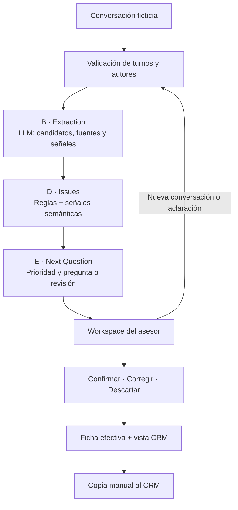

# Arquitectura técnica: qué decidí automatizar y qué no

[← Volver al README](../../README.md) · [Evolución del enfoque](PRODUCT_EVOLUTION.md)

En la primera versión de Sales Copilot había planteado una arquitectura bastante más amplia, con modelos de expediente, hitos comerciales y un agente capaz de avanzar por el proceso. Al pasar a AI Lead Intake quise evitar arrastrar esa complejidad y centrarme en una pregunta: **¿cuál es la arquitectura mínima que permite extraer información útil, detectar problemas y ayudar al asesor a decidir qué hacer después?**

La respuesta fue separar la interpretación del lenguaje natural de las reglas de negocio y de la revisión humana. No pretendía que un LLM tomase decisiones comerciales completas, sino darle una responsabilidad concreta y construir controles alrededor.

## El recorrido de una conversación

En la implementación, [`runIntake`](../../src/intake/run-intake.ts) ejecuta B → D → E en ese orden. El resultado contiene tanto la extracción como las incidencias y la intervención propuesta; no se reduce a una respuesta final de texto. Esto permite revisar por separado dónde se ha originado un problema.

### 1. Entrada: no adivinar quién ha dicho qué

Antes de llamar al modelo, [`parseConversation`](../../src/intake/parse-conversation.ts) convierte el texto a mensajes con autor explícito. Aceptamos los prefijos `Cliente:`, `Libeen:` y `Asesor:` y rechazamos entradas cuyo autor no pueda identificarse con seguridad.

Me parecía importante hacer esta comprobación antes de la inferencia: una cifra sugerida por el asesor no debería aparecer después como ingreso declarado por el cliente. Los audios sin transcripción se representan como contenido inaccesible, no como información que podamos reconstruir.

### 2. B — Extraction: usar el modelo donde aporta valor

Utilizamos una llamada a la **OpenAI Responses API** para interpretar la conversación y proponer candidatos de los siete campos comerciales: interés, zona, horizonte, compradores, ingresos, ahorros y cuotas/deudas.

Pido una salida estructurada y validada mediante Zod, pero no trato ese formato como garantía de corrección. Cada candidato incluye una referencia de mensaje, una cita literal y metadatos como precisión, sujeto y base de ingresos. Después de recibirlo, [`extraction.ts`](../../src/intake/extraction.ts) comprueba la forma de los datos y que la cita exista realmente en un mensaje del cliente.

Si un candidato es inválido, puede descartarse sin perder los demás. Para las expresiones de interés introdujimos además un filtro conservador, después de observar que menciones genéricas a vivienda podían terminar clasificadas como interés explícito por SmartHousing.

**Por qué una única extracción en lugar de varios agentes:** habíamos explorado un enfoque multipass en el Sales Copilot original y no encontramos evidencia suficiente de que justificase su coste y complejidad para esta V0. Preferí una llamada estructurada y pasos posteriores comprobables. Esto no significa que single-pass sea siempre mejor: es la decisión que tiene sentido con lo aprendido y con el alcance actual.

### 3. D — Issues: no delegar todo el criterio en el LLM

La extracción puede proponer señales semánticas, pero [`issues.ts`](../../src/intake/issues.ts) también aplica comprobaciones sobre los datos disponibles.

Por ejemplo, los campos esenciales que faltan se calculan desde los candidatos, sin pedirle al modelo que invente una lista de ausencias. Cuando hay una cuota declarada y no sabemos si ya está descontada de los ingresos, D puede crear la incidencia aunque el modelo haya omitido esa señal.

Esto lo añadimos por un fallo concreto observado durante las evaluaciones: una extracción podía conservar la cuota como desconocida y, aun así, no producir la incidencia necesaria para formular la pregunta correcta.

No intenté construir un motor universal de políticas comerciales. D contempla ausencias, ambigüedades, contenido inaccesible y posibles solicitudes sensibles; sigue habiendo casos donde una aclaración o una contradicción necesitan interpretación humana.

### 4. E — Next Question: una decisión pequeña y controlada

[`next-question.ts`](../../src/intake/next-question.ts) no realiza otra llamada al LLM. Selecciona una intervención a partir de las incidencias y unas prioridades explícitas:

- Una señal sensible lleva a revisión humana.
- Si no la hay, se prioriza una ambigüedad material.
- Después se pregunta por un campo esencial ausente.
- Si no queda nada prioritario, no se inventa una pregunta.

Las preguntas se construyen con plantillas y motivos de incidencia. Hay reglas específicas para dudas relevantes, como si una cuota está descontada de los ingresos o si estos son netos o brutos.

Es una simplificación consciente: no necesito un agente que redacte toda la conversación comercial para demostrar que podemos ayudar al asesor a escoger una siguiente acción. La propuesta es editable y nunca se envía automáticamente.

## La revisión humana no es una pantalla decorativa

La interfaz permite confirmar, corregir y descartar candidatos, además de añadir una continuación y reanalizar.

Una de las correcciones importantes fue separar los candidatos originales del **valor efectivo** de la ficha. Durante una revisión detecté que adoptar una declaración podía cambiar su aspecto en pantalla sin actualizar el dato que utilizaba el resto de la aplicación.

Por eso [`deriveEffective`](../../src/intake/effective.ts) reúne las decisiones del asesor, los candidatos y los conflictos para construir una representación compartida. Cuando la correspondencia no es clara, preferimos dejar el conflicto visible antes que elegir una cifra arbitrariamente. Las fuentes originales se conservan.

La [vista CRM](../../src/intake/export.ts) toma esa ficha efectiva e incluye procedencia, campos pendientes e incidencias. No hay integración con un CRM: el asesor copia el resultado manualmente. La copia puede bloquearse si el resultado está desactualizado, no hay información utilizable, quedan conflictos o la etapa necesita revisión.

## Qué ocurre cuando falla la inferencia

Quería que un error fuese visible, no que la aplicación pareciera funcionar gracias a una respuesta ficticia.

La ruta [`/api/intake`](../../src/app/api/intake/route.ts) valida la entrada y exige una clave OpenAI configurada en el servidor. El transporte utiliza un esquema de salida estructurada, un límite de 30 segundos y **ningún reintento automático del cliente** en la implementación actual.

Si falla el proveedor o no obtenemos una respuesta interpretable, el análisis devuelve un error. No existe un fallback silencioso a fixtures o replays. La interfaz debe distinguir el resultado nuevo del anterior cuando cambia la conversación.

Para detalles sobre descarte de candidatos, conflictos y errores conocidos, véase [Fiabilidad y limitaciones](AI_RELIABILITY_AND_LIMITATIONS.md).

## Por qué no incorporé más infraestructura

El stack es deliberadamente convencional:

| Responsabilidad | Elección |
| --- | --- |
| Aplicación y API | Next.js 16, React 19 y TypeScript |
| Extracción | OpenAI Responses API con salida estructurada |
| Validación | Zod y verificaciones de procedencia |
| Reglas y estado comercial | Funciones TypeScript |
| Tests | Vitest, Playwright y Axe |
| Estado del expediente | Temporal, durante la sesión del navegador |

No añadí base de datos, servicios separados, colas ni un framework genérico de agentes. En una prueba local con un expediente activo, esa infraestructura no ayudaba a resolver el principal riesgo del producto: **la calidad de las interpretaciones y cómo reaccionamos ante sus errores**.

La ausencia de persistencia también es un límite real: no hay cuentas, expedientes recuperables entre sesiones ni sincronización externa.

### Configuración: simple, pero no sin código

En [`src/intake/rules.ts`](../../src/intake/rules.ts) se definen los seis campos esenciales (cuotas/deudas es el séptimo campo, no obligatorio), el orden de ciertas ambigüedades y la prioridad de aclarar la base de ingresos.

Modificar estas reglas requiere editar TypeScript y reiniciar o reconstruir. No existe todavía configuración administrativa desde la interfaz, así que el requisito más ambicioso de cambiar reglas sin tocar código **no está cubierto literalmente**.

## Qué mejoraría después

Antes de añadir más autonomía, trabajaría en una evaluación más amplia de la extracción y de las aclaraciones, con casos anotados que permitan distinguir errores semánticos de decisiones de prioridad.

A partir de esa evidencia tendría sentido mejorar el vínculo entre declaraciones y aclaraciones, externalizar las reglas de negocio y decidir si merece la pena introducir persistencia. La [evolución del producto](PRODUCT_EVOLUTION.md) y el [roadmap](roadmap.md) recogen esas posibles fases.

**En resumen:** he utilizado el LLM para interpretar conversaciones, funciones deterministas para controlar las salidas y una interfaz de revisión para que el asesor conserve la última palabra. Esa separación es lo que hace que la PoC resulte evaluable, incluso cuando la extracción no sale perfecta.
