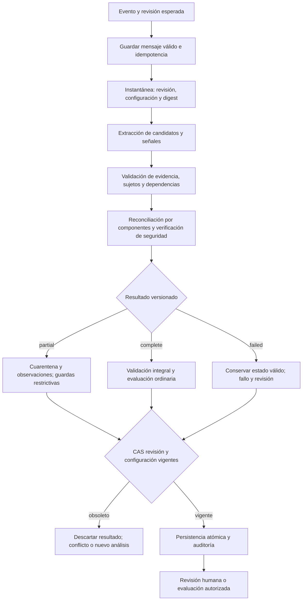

# F02-R03 — CCR: interpretación parcial y preservación de seguridad

**Estado: propuesta para revisión; no aprobada ni implementada.** Base: `codex/f02-first-live-c01` en `b1d32aa`. Propietario del contrato y decisión: integrador. Este documento no autoriza cambios en `src/contracts/**`, runtime, políticas o fixtures. La propuesta utiliza conversaciones sintéticas y no crea decisiones financieras, compromisos ni efectos externos.

## 1. Problema y evidencia

El puerto actual `Interpreter.interpret` devuelve `Promise<Result<Interpretation>>`; `Interpretation` solo contiene `assertions`, `blockers` y `warnings` ([ports.ts](../../src/contracts/ports.ts)). El adaptador multipass convierte `human_review_required` en `MODEL_OUTPUT_INVALID` y no entrega resultados parciales ([interpreter.ts](../../src/adapters/ai/multipass/interpreter.ts)). La reconciliación construye afirmaciones internamente pero, cuando existen motivos de revisión, retorna disputas y señales sin la lista de afirmaciones aceptadas ([reconcile.ts](../../src/adapters/ai/multipass/reconcile.ts)). El orquestador valida el lote completo; si hay error marca `analysis_failed`, invalida propuestas y no incorpora el resultado ([orchestrator.ts](../../src/application/cases/orchestrator.ts)). `evaluate` reconcilia todas las afirmaciones, evalúa política, workflow y acción sin un estado parcial ([evaluate.ts](../../src/application/cases/evaluate.ts)).

[R01](F02_R01_CAPTURED_REPLAY.md) reprodujo 21 casos de una etapa: 14 revisiones, 5 errores de validación y 2 resultados consolidados; la comparación cubrió estado y error o acción, no todos los campos. [R02](F02_R02_SEMANTIC_EVALUATION.md) observó nueve candidatos financieros de B01 correctos en los atributos etiquetados aunque el resultado global falló; B05 identificó TRUST; B10 identificó OPT_OUT en S1/S2 pero falló la cobertura S2; B08 identificó URGENT y omitió BINDING_CLAIM. Las capturas de `time_nonurgent-P2` produjeron OPT_OUT/STOP_CONTACT falso y una ubicación no respaldada. Estos resultados son una muestra pequeña con anotaciones provisionales, no prueban que las señales confirmadas por el modelo sean verdaderas ni que un verificador con el mismo modelo sea independiente.

**Causa de frontera:** `Result<Interpretation>` confunde indisponibilidad global con una revisión localizada y no transporta resultados con distinta autoridad. También falta un mecanismo canónico explícito para retener y resolver avisos, sin que ausencia posterior signifique cierre. Un cambio de forma por sí solo no valida evidencia, independencia entre grupos ni semántica de seguridad.

## 2. Alternativas

| | A — contrato actual y diagnóstico no autoritativo | B — resultado tipado versionado |
| --- | --- | --- |
| Diseño | Conservar fail-closed; exponer diagnóstico seguro al asesor fuera del estado canónico, sin añadir afirmaciones ni blockers si falla el lote. | Introducir resultado `complete`, `partial_review_required`, `failed`, con particiones y procedencia; persistencia parcial y guardas nuevas sujetas a aprobación. |
| Ventajas | Menor superficie de cambio; compatibilidad con adaptadores y snapshots; sin nueva vía de efectos. | Puede preservar hallazgos independientemente validados, explicar qué no se sabe y distinguir indisponibilidad de revisión. |
| Riesgos | Señales genuinas y hechos útiles siguen sin llegar al estado ni al evaluador; el asesor debe revisar manualmente y el caso puede quedar indisponible. Una UI no debe presentar el diagnóstico como confirmado. | Falsos positivos, confianza excesiva, particiones dependientes, bloqueo injustificado, pérdida de historial o acción con información incompleta. Mayor superficie de validación, persistencia y migración. |
| Coste | Bajo/medio: visibilidad, privacidad, acceso, retención y UI de diagnósticos. No resuelve la preservación autoritativa. | Alto: contrato, orquestación, persistencia y CAS, protección de propuestas, UI/revisión, adaptadores, pruebas, migración y coordinación del CCR de blockers. |

**Recomendación:** mantener A como comportamiento vigente durante la transición y diseñar B como evolución versionada en dos fases. Primero habilitar almacenamiento de revisión en cuarentena y validación de señales desacoplada, sin evaluación comercial parcial. Solo tras aprobación, migración y pruebas podrá B promover elementos verificados. Si no puede demostrarse independencia o completitud de las comprobaciones pertinentes, conservar A. La prioridad es no perder una señal genuina **sin** convertir un resultado del modelo o una cita literal en verdad.

## 3. Contrato propuesto (especificación, no código existente)

El siguiente pseudocódigo TypeScript/Zod ilustra forma y refinamientos necesarios; los nombres, tipos, versionado y tratamiento de datos requieren aprobación. `EvidenceRef`, `FactAssertion`, `ApplicationError` y `ConfigBundleRef` refieren a los contratos existentes, sujetos a validación adicional, no son garantías por sí mismos.

```ts
type Provenance = {
  contractVersion: 'interpretation-v2';
  analysisId: string; inputEventId: string; caseId: string;
  inputRevision: number; inputDigest: string; configBundleRef: ConfigBundleRef;
  mode: 'openai' | 'replay'; adapterVersion: string;
  extractionVersion: string; verificationVersion: string;
  reconciliationVersion: string; validationVersion: string;
};
type Issue = {
  issueId: string; stage: 'extraction' | 'verification' | 'reconciliation' | 'safety' | 'history';
  code: string; affectedIds: string[]; evidenceRefs: EvidenceRef[];
};
type AcceptedAssertion = {
  assertion: FactAssertion; validationReceiptId: string; dependencyIds: string[];
};
type UnresolvedAssertion = {
  candidateId: string; fieldId?: string; evidenceRefs: EvidenceRef[];
  disposition: 'unresolved' | 'rejected'; issueIds: string[];
};
type SafetyObservation = {
  observationId: string; category: 'OPT_OUT' | 'TRUST' | 'URGENT' | 'BINDING_CLAIM';
  evidenceRefs: EvidenceRef[]; validationReceiptId: string;
  disposition: 'verified' | 'uncertain'; issueIds: string[];
};
type PartialInterpretation = {
  accepted: AcceptedAssertion[]; unresolved: UnresolvedAssertion[];
  verifiedSafety: SafetyObservation[]; uncertainSafety: SafetyObservation[];
  issues: Issue[]; provenance: Provenance;
};
type InterpretationOutcome =
  | { status: 'complete'; interpretation: Interpretation; provenance: Provenance }
  | { status: 'partial_review_required'; partial: PartialInterpretation }
  | { status: 'failed'; error: ApplicationError; provenance: Provenance };
interface InterpreterV2 {
  interpret(input: InterpreterInput): Promise<InterpretationOutcome>;
}
```

Esquema conceptual Zod: `z.discriminatedUnion('status', [z.strictObject({...}), ...])`; cada variante es estricta y contiene exactamente los campos indicados. `partial_review_required` requiere al menos un `issue`, IDs únicos y referencias internas resolubles; `verifiedSafety` solo admite `disposition: 'verified'`, `uncertainSafety` solo `'uncertain'`. `complete` exige validación integral, cobertura de seguridad y ausencia de conflictos pendientes; `failed` nunca transporta contenido autoritativo. Un `validationReceiptId` referencia un registro inmutable interno, **no un certificado emitido por el modelo**: identifica reglas, versión, entradas, resultado y dependencias; solo el verificador confiable de aplicación puede emitirlo. La mera validez Zod no prueba soporte semántico, independencia ni autoridad. El esquema final debe acotar tamaños, datos sensibles, valores y códigos; mensajes y salidas del modelo son datos no confiables.

**Semántica:**

1. `accepted` significa que el candidato supera validación sintáctica, evidencia y reconciliación para su componente; no significa que el asesor haya confirmado ni que sea elegible. Mantener `reviewStatus` existente y distinguir `confirmed_by_advisor`, `unreviewed` y `rejected`. En B inicial se recomienda cuarentena de todas las afirmaciones parciales, incluso aceptadas; no mezclar con `CaseKnowledge` hasta la decisión humana o el mecanismo explícitamente aprobado.
2. `unresolved`/`rejected` no son hechos ni se insertan en `CaseKnowledge`; conservar referencias seguras, motivo y estado de revisión para el asesor. No almacenar texto del modelo arbitrario como instrucción ejecutable.
3. `verifiedSafety` significa verificada según reglas, evidencia y cobertura aprobadas; no que el modelo la haya calificado como confirmada. `uncertainSafety` activa revisión restrictiva sin crear un `Blocker` confirmado. Un resultado semánticamente dudoso o una salida S2 incompleta no adquiere autoridad por repetición.
4. El límite de independencia debe determinarse por grafo de dependencias (ocurrencia, sujeto, correcciones, evidencia, histórico y política). IDs de grupos diferentes o tres extractores no prueban independencia. Conflicto de identidad, evidencia compartida ambigua, corrección o dependencia desconocida contaminan el componente afectado; un fallo estructural global que impida identificar componentes convierte el resultado en `failed` o cuarentena total.
5. El ámbito de validación de seguridad es separado del de hechos. La falta de una revisión por candidato S2 no autoriza por sí sola la promoción de la señal: requiere recibo independiente que valide evidencia, categoría, identidad, integridad y cobertura aplicable. El modelo puede proponer observaciones; no firma recibos de autoridad.

## 4. Flujo y puntos de persistencia propuestos



La recepción del mensaje válido es un commit separado previo a IA, como en V0. `analysisId` identifica intento y `inputEventId` la causa; se liga al `caseId`, revisión, digest de mensajes/histórico relevante y `configBundleRef`. La escritura posterior de diagnóstico, cuarentena, guardas, invalidación de propuestas y decisión de revisión debe ser atómica bajo CAS de revisión y comprobación de configuración. Si hay cambio concurrente de mensajes, correcciones, revisión humana o configuración, **ninguna parte** del resultado antiguo se fusiona: devolver conflicto y reanalizar explícitamente. No hacer rebase automático.

`eventId` más payload idéntico devuelve recibo estable sin repetir interpretación ni efectos; payload distinto implica `IDEMPOTENCY_CONFLICT`. Reintentos de transporte usan identidad de intento separada; deduplicar hallazgos por identidad estable, evidencia y versión sin sobrescribir divergencias. Un `analysisId` duplicado con contenido distinto se rechaza y audita. El storage debe permitir transacción o equivalente para impedir hechos sin guardas; definir recuperación tras crash y verificar persistencia real, no solo memoria. El almacenamiento de diagnósticos tiene límites de acceso, retención y contenido; excluir secretos y excepciones crudas.

En parcial se invalidan propuestas y borradores dependientes de la revisión anterior; no se llaman el evaluador comercial ordinario ni el generador de borradores. Se mantiene el último workflow confirmado como histórico, identificado como no actualizado; no completar ni ampliar hitos por el parcial. Solo se permite una proyección restrictiva separada, p. ej. `ON_HOLD_REVIEW`, y, si la protección está debidamente verificada y la política aprobada lo permite, el bloqueo de contacto correspondiente. En ningún caso se autoriza contacto, cita, aprobación o decisión financiera. La incertidumbre obliga a revisión sin presentarla como blocker confirmado. El asesor no puede aprobar una propuesta cuyo `originCaseRevision` o configuración sea obsoleto; exige reevaluación y una nueva propuesta.

Para promoción humana, proponer evento tipado específico con actor asesor, revisión esperada, ID de análisis/elemento, decisión, motivo y evidencia. Debe conservar la observación previa y el estado de revisión, validar permisos, mensaje y evidencia y volver a reconciliar dependencias; no sustituir silenciosamente una afirmación previa. La forma exacta, permisos y estado de resolución son decisión del integrador. Si se autoriza la promoción automática de un subconjunto en una fase posterior, debe demostrarse independencia y bloquear toda acción dependiente de lo no resuelto; no se incluye en la fase inicial recomendada.

## 5. Compatibilidad y consumidores

| Consumidor / productor | Impacto y transición propuesta |
| --- | --- |
| `src/contracts/ports.ts`, `errors.ts` | Nuevo puerto/union versionado: cambio incompatible si se sustituye in situ. Mantener V1 y añadir V2 con negociación explícita. No reinterpretar un error V1 como parcial. |
| Single-pass OpenAI | Puente V1→V2: éxito íntegro validado → `complete` solo si satisface las garantías V2; de otro modo revisión o `failed`. Error → `failed`. No afirmar procedencia de verificadores inexistentes. |
| Replay | Puente explícito con `mode: replay`; conservar etiquetas y fixtures existentes; no presentar replay como inferencia real. Si no puede producir recibos compatibles, permanecer en V1/fail-closed; no fabricar verificación. |
| Multipass, validadores y reconciliador | Separar componentes y seguridad, emitir recibos y cobertura; no basta devolver el array interno. Conservar fallos globales como `failed`. |
| Orquestador y repositorio | Nueva vía parcial, CAS, idempotencia, auditoría y atomicidad; almacenamiento de cuarentena. Sin puerto V2, comportamiento V1 intacto. |
| `CaseSnapshot`, eventos, decisiones y serialización | `analysisStatus` actual admite solo `pending`, `complete`, `analysis_failed`. V2 requiere extensión/versionado y estrategia de lectura/escritura, eventos de revisión y decisión trazable. Snapshots V1 se leen sin inventar datos y se migran conservadoramente. |
| Facts, workflow, policy, planner, borradores | No consumen candidatos en cuarentena. Requieren puerta explícita para impedir evaluación, hitos y drafts durante parcial; protecciones anteriores prevalecen. |
| UI, API, auditoría, pruebas y evaluadores | Mostrar parcial, no resuelto y procedencia sin confundir verificación con aprobación humana; manejar versión desconocida como no disponible y no filtrar contenido sensible. Actualizar pruebas de contrato y aceptación sin modificar oráculos históricos. |

Un consumidor V1 que reciba V2 mediante adaptador inverso debe mapear `partial_review_required` a fallo/revisión fail-closed, nunca a `Interpretation` completa. Los cambios requieren contrato publicado primero por integrador, pruebas de compatibilidad, migración controlada y rollback; ninguna conversión automática cerrará blockers ni cambiará revisiones históricas.

## 6. Seguridad, historial y CCR previo

La propuesta **complementa, no aprueba ni sustituye** [F01 blocker lifecycle CCR](F01_BLOCKER_LIFECYCLE_CCR.md): ese CCR define una operación explícita y evidenciada para distinguir etiqueta original incorrecta de resolución posterior, con autoridad y auditoría. Aquí se propone cómo transportar observaciones parciales y conservar guardas. Ninguna omisión en un análisis posterior resuelve o invalida un blocker existente; no sobrescribir `resolved/open` ni su evidencia o revisión por ausencia. Bloqueadores heredados se mantienen conservadoramente hasta operación autorizada; tratar una incertidumbre nueva como revisión no como cierre ni confirmación. La promoción de `verifiedSafety` a `Blocker` requiere resolver previamente identidad, deduplicación, autoridad, ciclo de vida y prioridad junto con el CCR F01.

Una señal incierta o un opt-out plausible no verificado impone pausa de contacto y revisión, **sin** registrarlo falsamente como blocker confirmado. Un OPT_OUT genuino con evidencia y validación autorizada debe prevalecer sobre preferencias del perfil y acciones comerciales. Una vez abierto o confirmado por operación autorizada, su levantamiento requiere el proceso explícito aplicable; ningún modelo o silencio lo cierra. BINDING_CLAIM impide promesas; URGENT y TRUST conducen a revisión según política aprobada, no a aprobaciones o citas. No tratar un acuerdo modelo-modelo como verificación independiente.

## 7. Matriz de conformidad y regresión propuesta

Estas son pruebas futuras de aceptación, **no resultados ejecutados**. Para cada prueba verificar además `caseId`, versiones, evidencia, revisión, auditoría, ausencia de efectos y que los valores previos sigan intactos.

| Caso | Resultado esperado bajo la propuesta |
| --- | --- |
| B01 | Los hechos financieros solo pasan a cuarentena si cada componente supera validaciones; ingreso conjunto aproximado 3.800 neto, ahorro aproximado 18.000 y deuda 250/mes conservan citas y sujetos. La revisión de otro componente no descarta candidatos independientes ni completa M3. No deducir deuda dos veces. |
| B05 | TRUST con recibo válido puede conservarse como observación verificada aunque buyer_count requiera revisión; si la validación de seguridad depende de una S2 incompleta, queda incierto. No inferir audio; no generar acción comercial parcial. |
| B08 | Preservar ahorro explícito cero si es validado, y URGENT si supera validación separada; la omisión histórica de BINDING_CLAIM no se corrige inventándola. La cobertura incompleta exige revisión; ninguna promesa de aprobación. |
| B10 | Ante S2 incompleta, no elevar automáticamente el OPT_OUT confirmado por el modelo; pausa restrictiva y revisión. Si una verificación separada aprobada acredita la petición literal, conservar la señal con recibo y aplicar protección autorizada; la falla de hechos no la elimina. |
| time_nonurgent-P2 | Cita temporal no autoriza OPT_OUT ni STOP_CONTACT confirmado; información dudosa requiere revisión si hay incertidumbre. «Ciudad de referencia» no establece ubicación deseada. Proteger también opt-out genuino. |
| C01 y correcciones históricas | Asociar corrección a afirmación y fuente previa, conservar evidencia y estados de revisión; neto→bruto sin repetir importe no crea cifra nueva. Reabrir dependencias y no derivar un estado sin historial reconstruido. |
| Cita inexistente, mensaje ajeno o rango inválido | Rechazar o dejar pendiente el componente afectado; jamás admitirlo por una cita en otro mensaje. Si no puede aislarse, fallar el lote. |
| Audio sin transcripción | No extraer texto o hechos del audio; conservarlo como no evaluable y pedir revisión. |
| Identidades o correcciones contradictorias | No atribuir ni fusionar sujetos arbitrariamente; poner el componente dependiente en cuarentena y preservar evidencia histórica. |
| Proveedor ausente, timeout o salida estructuralmente inválida | `failed` cuando no existe base validada; mensaje recibido permanece, no se promueven resultados ni se cierran avisos; reintento explícito. |
| Falso OPT_OUT y señal incierta | No abrir blocker confirmado ni presentar cese como hecho verificado; imponer pausa conservadora mientras se revisa; un descarte posterior sigue la operación de lifecycle aprobada. |
| Análisis concurrente, revisión o cambio de config | CAS/digest fallan; ni cuarentena ni señales obsoletas se aplican parcialmente. Estado nuevo y recibos anteriores sobreviven. |
| Mismo evento/payload y mismo análisis | Resultado idempotente sin duplicados; payload distinto o IDs incompatibles se rechazan. Simular caída entre recepción y commit y comprobar recuperación. |
| Propuesta/borrador obsoleto | Cambio de revisión, señal o configuración invalida la propuesta; `DRAFT_APPROVED` rechaza `STALE_PROPOSAL`, sin envío ni M5. |
| Blocker previo omitido | Permanece abierto y con evidencia; solo operación de lifecycle autorizada puede modificarlo. |
| Puentes V1/V2 y migración | Éxito V1 no presume validaciones V2 ausentes; error no se convierte en parcial; V2 parcial visto por V1 falla cerrado. Replay conserva modo, fixtures, historial y estados de revisión. |

## 8. Decisiones requeridas y plan de integración

1. Aprobar o rechazar B y el orden de fases; confirmar si todo hecho parcial permanece en cuarentena hasta revisión y qué guardas restrictivas pueden activarse automáticamente.
2. Definir estándar de validación semántica de señales, autoridad del recibo, cobertura mínima y cómo evitar correlación entre extractor y verificador; decidir si B10 permite verificación separada cuando falla S2. El recibo es un requisito de diseño, no tecnología ya disponible.
3. Aprobar representación y ciclo de vida de observaciones, estado `partial_review_required`, eventos humanos, permisos, privacidad, retención y proyecciones UI; coordinar identidad y cierre con CCR F01.
4. Definir versiones y migración/rollback para snapshots, puertos, adaptadores V1, single-pass y replay; determinar digest, fuentes de versión, transacción y comportamiento frente a reintentos y cambios de configuración.
5. Aprobar casos de aceptación, adjudicación independiente del oráculo, estrategia de pruebas adversariales y gate de integración. No usar el holdout para ajustar validadores.

Tras aprobación, el integrador publica primero contratos y migraciones, luego adapta persistencia/orquestación y consumidores, ejecuta pruebas de contrato, concurrencia y seguridad, y finalmente habilita V2 por capacidad explícita. Hasta entonces no se implementa ni se considera autorizado el cambio. La alternativa A y la investigación de diagnósticos siguen disponibles independientemente.

## 9. Verificación de R03

- Comprobación local de enlaces Markdown y presencia de temas obligatorios: **PASS**, 8 enlaces comprobados, ninguno ausente. Esta comprobación no aprueba el diseño.
- `F02_CAPTURED_ZIP="$PWD/.eval-results/f02-24-20261115-multipass.zip" pnpm exec vitest run tests/evaluation/f02-captured-replay.test.ts`: **PASS**, 1 test; replay offline de las 21 ejecuciones de una etapa.
- `git diff --check`: **PASS**. No se ejecutaron pruebas de implementación V2: no existe implementación y la matriz anterior es propuesta. No se ejecutaron build ni pruebas de proveedor porque el cambio es documental.
