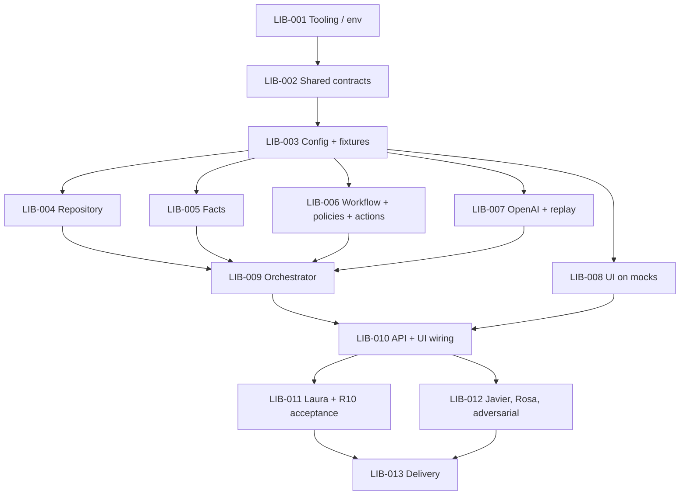

# DAG de implementación V0 — LIB-001 a LIB-013

**Corte histórico (13/11/2026):** planificación; ninguna tarea se había ejecutado al añadir estos documentos. Repo principal privado: `w0xter/libeen-sales-copilot`; stack existente Next.js/React/TypeScript/pnpm. OpenAI con `gpt-4.1-mini` seleccionable mediante `OPENAI_MODEL` en `.env` (por implementar). **Última actualización documental:** 2026-11-13.

> **Ejecución observada (14/11/2026):** LIB-001 a LIB-012 implementadas; G0–G3 verificados. LIB-013 y G4 siguen pendientes de validación de entrega limpia. Los resultados, riesgos y cambios de contrato reales están en [AI_DEVELOPMENT_LOG.md](../AI_DEVELOPMENT_LOG.md); no se ha ejecutado un modelo OpenAI real.

## Grafo

## Tabla de tareas

| Nodo | Nombre | Depende de | Gate | Responsable de trabajo propuesto |
| --- | --- | --- | --- | --- |
| [LIB-001](tasks/LIB-001.md) | Tooling, `.env`, scripts y normas Codex | — | G0 | Integrador |
| [LIB-002](tasks/LIB-002.md) | Contratos TypeScript/Zod y puertos | 001 | G0 | Integrador |
| [LIB-003](tasks/LIB-003.md) | Workflow, FactSchema, políticas, agente y fixtures | 002 | G0 | Integrador |
| [LIB-004](tasks/LIB-004.md) | Case Repository, CAS, idempotencia, reset | 003 | G1 | Integrador |
| [LIB-005](tasks/LIB-005.md) | Fact Reconciler y CaseKnowledge | 003 | G1 | Codex Facts |
| [LIB-006](tasks/LIB-006.md) | Milestone/Policy Evaluators y Action Planner | 003 | G1 | Codex Workflow |
| [LIB-007](tasks/LIB-007.md) | OpenAI Interpreter/DraftGenerator + replay | 003 | G1 | Codex AI |
| [LIB-008](tasks/LIB-008.md) | React Case Workspace con mocks tipados | 003 | G1 | Codex UI |
| [LIB-009](tasks/LIB-009.md) | CaseOrchestrator: eventos, commits, errores | 004/005/006/007 | G2 | Integrador |
| [LIB-010](tasks/LIB-010.md) | Endpoints Next.js + UI integrada | 008/009 | G2 | Integrador/UI tras merge |
| [LIB-011](tasks/LIB-011.md) | Aceptación Laura y modificación de R10 | 010 | G3 | QA/Integrador |
| [LIB-012](tasks/LIB-012.md) | Javier, Rosa, fallos y seguridad | 010 | G3 | QA/Integrador |
| [LIB-013](tasks/LIB-013.md) | Entrega reproducible, README y log de IA | 011/012 | G4 | Integrador |

## Oleadas de paralelismo

- **Fundamentos secuenciales:** LIB-001 → LIB-002 → LIB-003. No paralelizar ediciones de scripts, contratos ni fixtures compartidos.
- **Primera oleada paralela:** LIB-005, 006, 007 y 008 en cuatro worktrees separados, más LIB-004 del integrador; **no** abrir antes de validar G0.
- **Convergencia:** LIB-009 espera por 004, 005, 006, 007. LIB-010 espera por 009 y 008, y solo tras integrar UI.
- **Segunda oleada paralela:** LIB-011 y LIB-012 tras LIB-010.
- **Cierre secuencial:** LIB-013 tras ambas suites de aceptación.

El camino de dependencias estructural más largo pasa por LIB-001 → 002 → 003 → (004/005/006/007) → 009 → 010 → (011/012) → 013. **No** es una estimación de horas ni se ha medido duración real.

## Gates

| Gate | Para abrir | Para cerrar |
| --- | --- | --- |
| **G0** | Repo scaffold real | Tooling, contracts validables, configuraciones y fixtures sintéticos compartidos; scripts verificables |
| **G1** | G0 cerrado | Tests de rama + contrato + typecheck/lint, rutas propias respetadas, evidencia de fallos |
| **G2** | Módulos proveedores + UI mock integrados | Recorrido Laura en replay vía API/UI, sin efectos reales, error handling |
| **G3** | G2 cerrado | Laura/R10 y Javier/Rosa/adversarial verificados, sin alterar fixtures para ocultar fallos |
| **G4** | G3 cerrado | Reproducción local, documentación actualizada, registro Codex real, revisión de secretos |

## Regla de desbloqueo

Un nodo solo está **Ready** cuando todas sus dependencias directas están integradas y verificadas; una rama que consume contratos estáticos puede trabajar con mocks sin esperar al código de otro workstream, pero **no** puede modificar interfaces compartidas sin autorización. La integración la realiza un único integrador con merges secuenciales.

Los scripts `pnpm test` / `pnpm typecheck` y dependencias se añaden en LIB-001. Hasta entonces, no se debe afirmar que estos comandos existen o han pasado. El repo del ejercicio no contiene integración productiva, aprobaciones financieras ni envío real.

## Registro histórico de progreso (13/11/2026)

| Gate | Estado documental | Estado de código |
| --- | --- | --- |
| G0 | Planificado | No verificado |
| G1 | Planificado | No verificado |
| G2 | Planificado | No verificado |
| G3 | Planificado | No verificado |
| G4 | Planificado | No verificado |

Cuando comiencen las tareas se deben registrar las pruebas reales en [AI_DEVELOPMENT_LOG](../AI_DEVELOPMENT_LOG.md), no anticiparlas en este archivo.
